<div align="center">


# Rocket Odyssey

**Design a space mission, balance every trade-off, light the engines, and find out why it reached orbit or didn't.**

An educational browser game in which physics, not a lookup table, decides the outcome.

[](https://rocket-odysseyserver-production.up.railway.app)


[Play online](https://rocket-odysseyserver-production.up.railway.app) · [How it plays](#how-a-mission-plays) · [The physics](#the-physics) · [Run it locally](#getting-started) · [Architecture](#architecture)

<br>

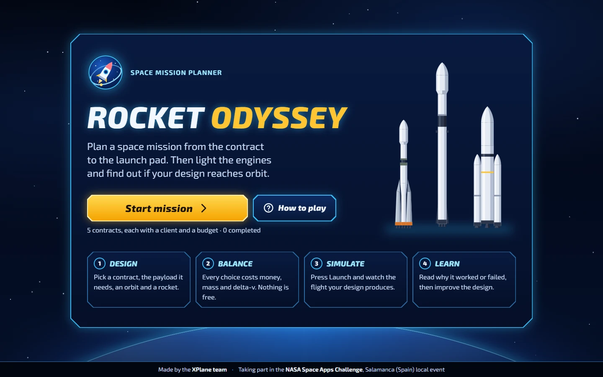

</div>

<br>

## Overview

Rocket Odyssey puts the player in charge of a launch campaign. A client offers a contract with a budget. The player picks the payload, the orbit and the launcher, and every choice costs money, mass and delta-v. Then the engines light and the flight shows whether the design holds up.

The game never just marks a design right or wrong. The debrief explains what happened in plain words, points to the decision that caused it and sends the player back to fix it.

<p align="center">
  <b>DESIGN</b> &nbsp;→&nbsp; <b>BALANCE</b> &nbsp;→&nbsp; <b>SIMULATE</b> &nbsp;→&nbsp; <b>LEARN</b> &nbsp;→&nbsp; <b>IMPROVE</b>
</p>

<p align="center">
  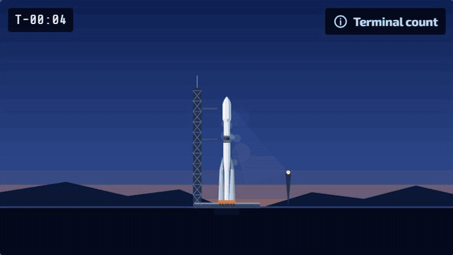
</p>

### Highlights

<table>
  <tr>
    <td width="33%" valign="top">
      <h4>Real trade-offs</h4>
      Five contracts, 12 payloads, 5 orbits and 8 launchers, from Electron to Saturn V. There is no single correct answer, only designs that cost more or keep more in reserve.
    </td>
    <td width="33%" valign="top">
      <h4>Physics decides</h4>
      Delta-v comes from the rocket equation, applied stage by stage. The simulation is deterministic: the same design always flies the same way.
    </td>
    <td width="33%" valign="top">
      <h4>A launch worth watching</h4>
      An animated flight with live telemetry, a mission event log, a trajectory map, engine sound and a payload deployment drawn for each type of payload.
    </td>
  </tr>
  <tr>
    <td valign="top">
      <h4>Explains, not just grades</h4>
      Every flight is reviewed against five rules. The debrief says why it worked or failed, gives a hint, and scores successful designs out of 100.
    </td>
    <td valign="top">
      <h4>Free exploration</h4>
      A sandbox with no contract and no budget. Fly anything on anything and see what physics allows.
    </td>
    <td valign="top">
      <h4>Accessible by design</h4>
      Built to WCAG 2.1 AA: fully playable with the keyboard, reduced-motion mode, text alternatives for the canvas and layouts down to 320 px.
    </td>
  </tr>
</table>

## How a mission plays

Planning has five steps. The player can move freely between them, and the budget meter in the header updates with every choice.

<table>
  <tr>
    <td width="50%" valign="top">
      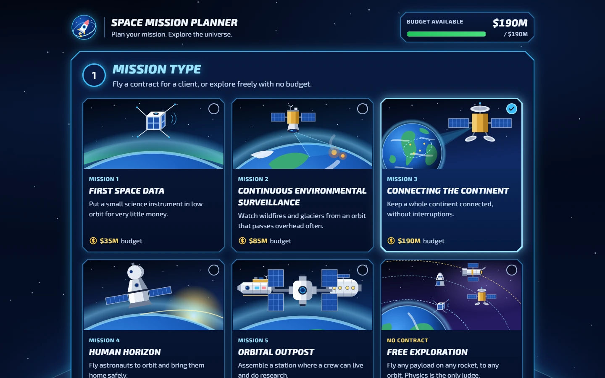
      <p><b>1. Mission.</b> Choose a contract. Each one has a client, a goal and a maximum budget. The last card is free exploration.</p>
    </td>
    <td width="50%" valign="top">
      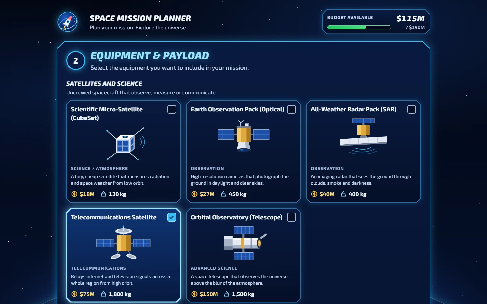
      <p><b>2. Equipment &amp; payload.</b> Combine satellites, crewed capsules and station modules. Their mass and cost add up.</p>
    </td>
  </tr>
  <tr>
    <td valign="top">
      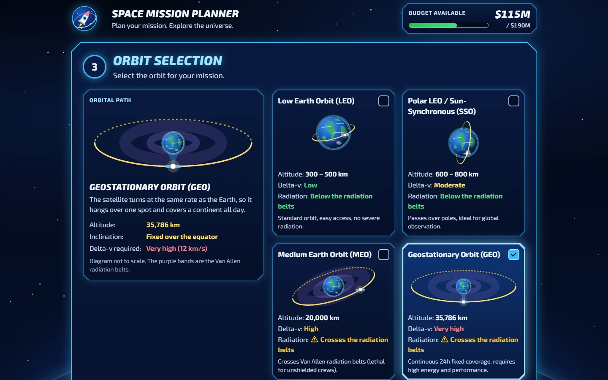
      <p><b>3. Orbit.</b> Higher orbits need more delta-v, and some cross the Van Allen radiation belts.</p>
    </td>
    <td valign="top">
      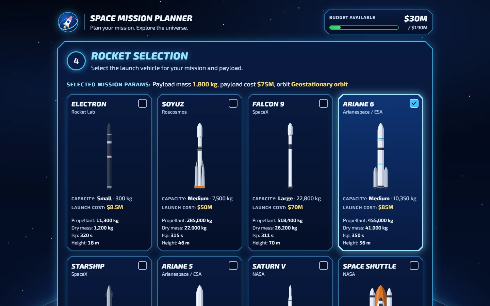
      <p><b>4. Rocket.</b> Compare capacity, cost, propellant and specific impulse across eight launchers.</p>
    </td>
  </tr>
  <tr>
    <td valign="top">
      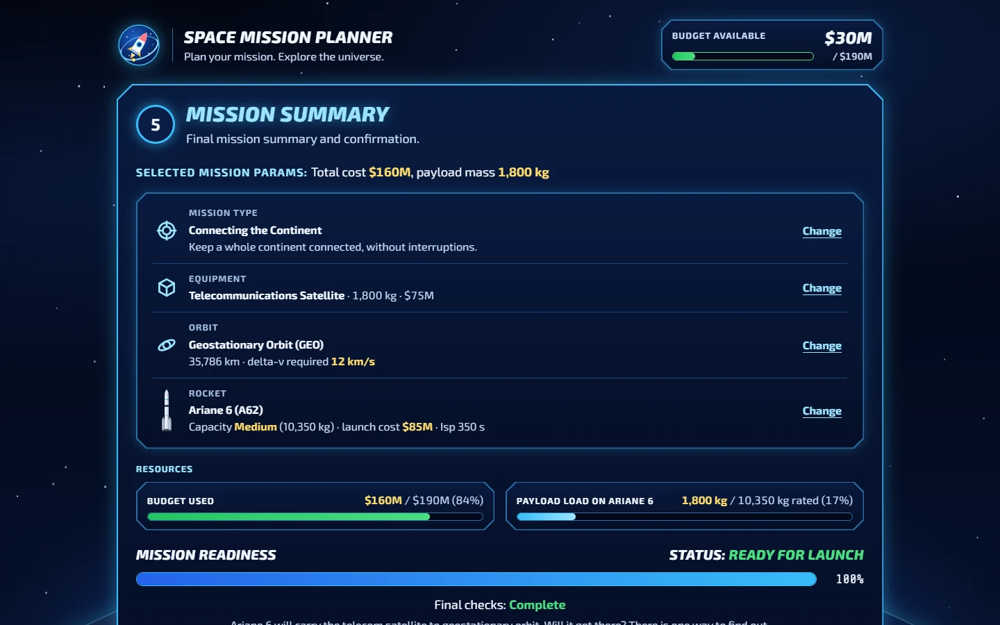
      <p><b>5. Summary.</b> Review the whole design, the budget used and the load on the rocket. Then press <i>Launch!</i></p>
    </td>
    <td valign="top">
      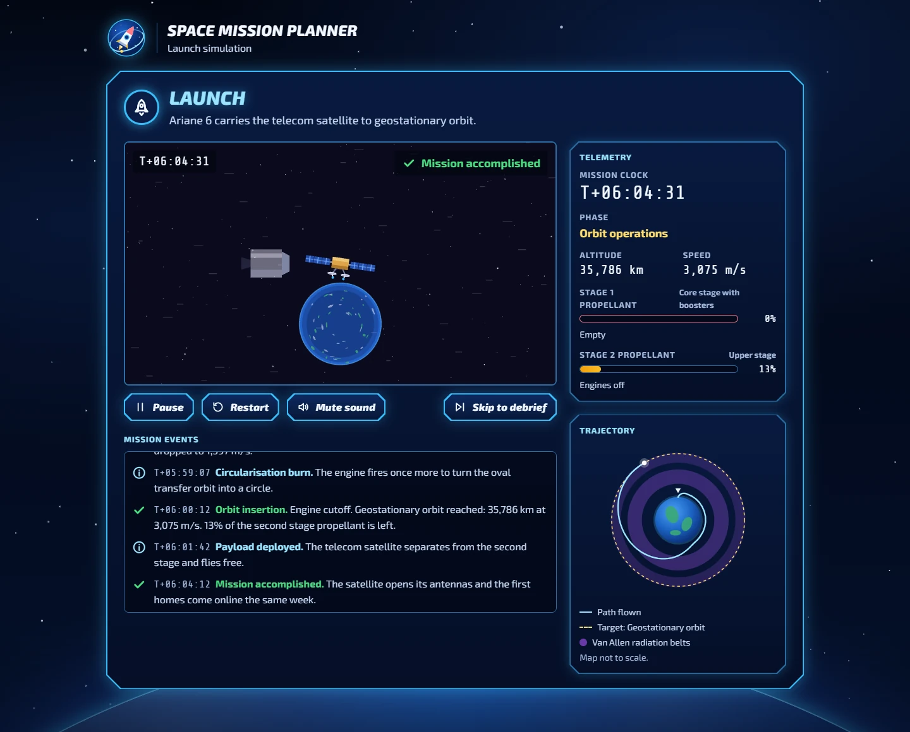
      <p><b>Launch.</b> Watch the flight with telemetry, an event log and the trajectory. Pause, restart or skip at any time.</p>
    </td>
  </tr>
</table>

### The debrief

Every flight is judged against five rules, in the order they matter in flight: **budget**, **payload mass**, **delta-v**, **crew radiation** and **contract objective**. The debrief marks the rule that ended the mission, explains it, gives a hint and links back to the step that can fix it. A successful contract earns a score out of 100, and only the best possible design for that contract scores 100.

<table>
  <tr>
    <td width="50%" valign="top">
      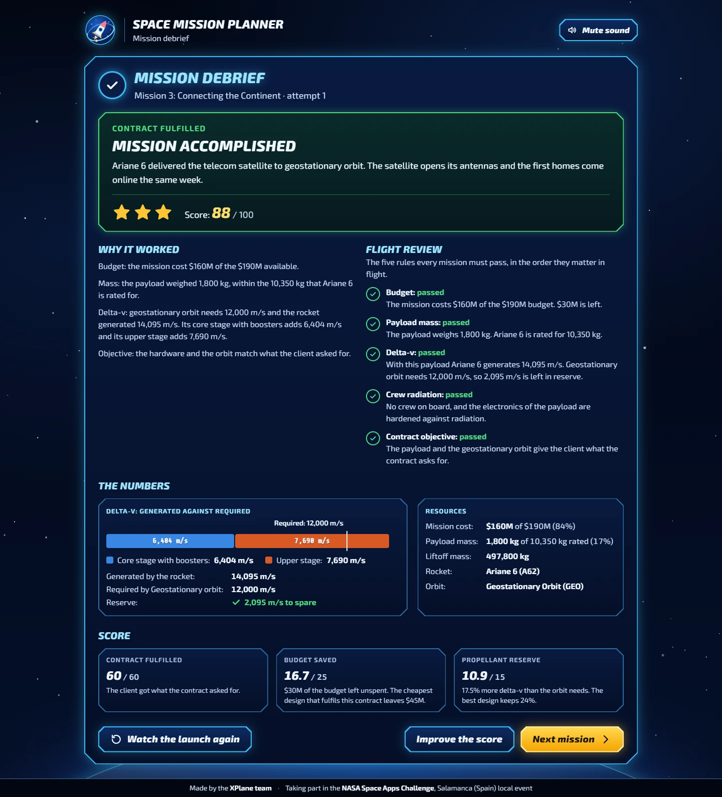
      <p align="center"><b>Mission accomplished</b>, with the score and how to improve it</p>
    </td>
    <td width="50%" valign="top">
      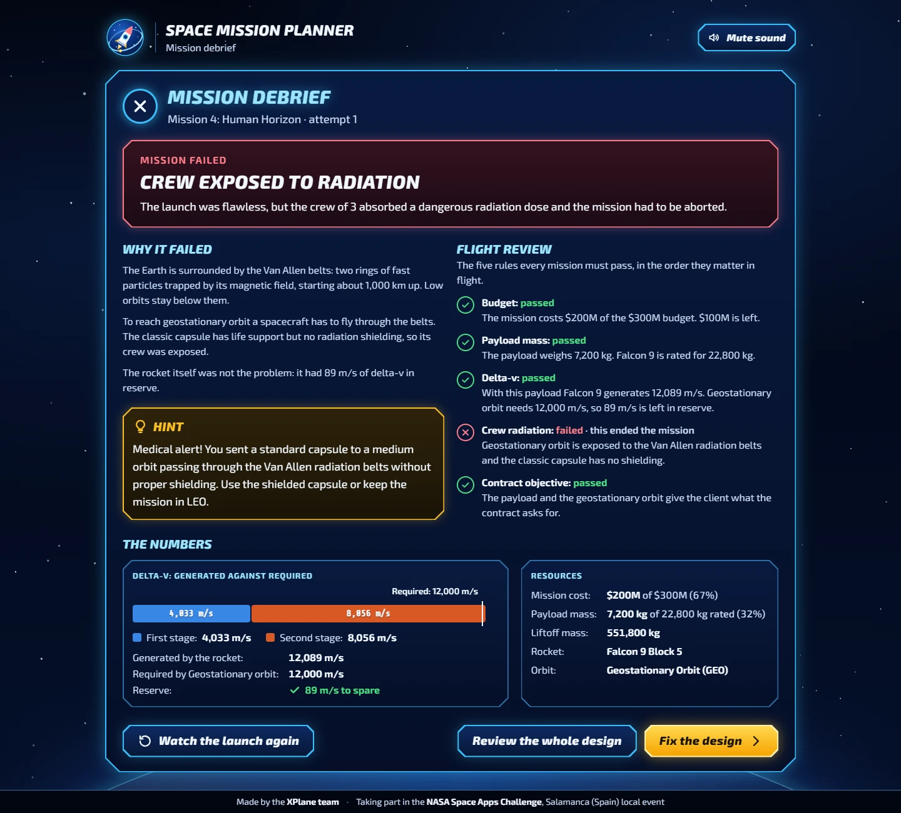
      <p align="center"><b>Mission failed</b>, with the reason and a hint</p>
    </td>
  </tr>
</table>

## Missions

|  #  | Contract                                  | Goal                                                                   | Budget |
| :-: | ----------------------------------------- | ---------------------------------------------------------------------- | -----: |
|  1  | **First Space Data**                      | Put a small science instrument in low orbit for very little money.     |   $35M |
|  2  | **Continuous Environmental Surveillance** | Watch wildfires and glaciers from an orbit that passes overhead often. |   $85M |
|  3  | **Connecting the Continent**              | Keep a whole continent connected, without interruptions.               |  $190M |
|  4  | **Human Horizon**                         | Fly astronauts to orbit and bring them home safely.                    |  $300M |
|  5  | **Orbital Outpost**                       | Assemble a station where a crew can live and do research.              |  $520M |

## Free exploration

No contract, no budget and no score. Choose it as the last card of step 1, after the five contracts. Then choose any payloads, any orbit and any rocket, whatever they cost. The cost is still shown, but physics is the only judge: payload mass, delta-v and radiation can still end the flight.

<p align="center">
  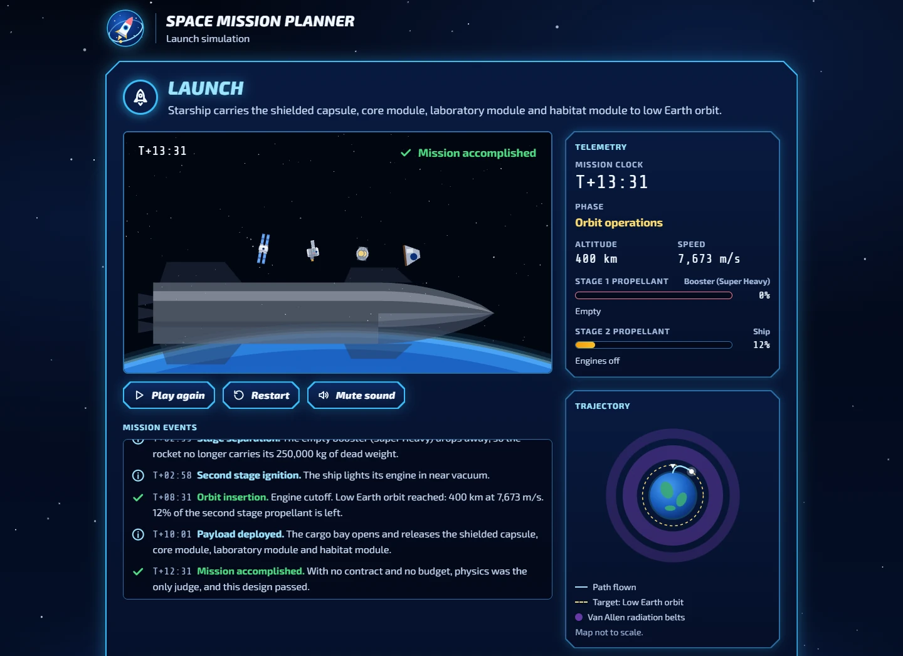
</p>

## The physics

The launcher's delta-v comes from the Tsiolkovsky rocket equation, applied to each stage in turn. When the first stage is empty it is dropped, so the second stage pushes a lighter vehicle:

$$
\Delta v = \sum_{i=1}^{2} I_{sp,i} \cdot g_0 \cdot \ln\frac{m_{\text{ignition},i}}{m_{\text{burnout},i}}
$$

A design reaches its orbit when that budget covers the delta-v the orbit requires:

| Orbit                                 | Altitude                 | Delta-v required | Van Allen belts |
| ------------------------------------- | ------------------------ | ---------------: | :-------------: |
| Low Earth Orbit (LEO)                 | 300 – 500 km             |         9.3 km/s |      Below      |
| Polar LEO / Sun-synchronous (SSO)     | 600 – 800 km             |         9.8 km/s |      Below      |
| Medium Earth Orbit (MEO)              | 20,000 km                |        11.2 km/s |     Crosses     |
| High Elliptical Orbit (HEO / Molniya) | High apogee, low perigee |        11.5 km/s |     Crosses     |
| Geostationary Orbit (GEO)             | 35,786 km                |        12.0 km/s |     Crosses     |

A launch is **computed first and animated second**. `simulate(design)` returns the outcome, a timeline of flight events and the reasons for the outcome. The canvas only plays that timeline back, and the debrief is written from the same data, so what you see and what you read always agree.

## Accessibility

The target is WCAG 2.1 AA, and a canvas is invisible to assistive technology, so it never carries information alone.

- **Text next to the canvas.** Telemetry is DOM text, mission events go to an `aria-live` log, and the result is plain text in the debrief.
- **Reduced motion.** When the system asks for less motion, the launch is shown as a step-by-step timeline. The animation is still one button away.
- **Control over time and sound.** The launch can be paused, restarted and skipped. One remembered setting mutes the engines and the music.
- **Keyboard first.** Option cards are real radio buttons and checkboxes, dialogs trap focus, and focus moves to the heading of each new screen.
- **No flashing.** Nothing flashes more than three times per second, including explosions.
- **Checked automatically.** The end-to-end tests run axe on every screen and play a whole mission with the keyboard alone.

<p align="center">
  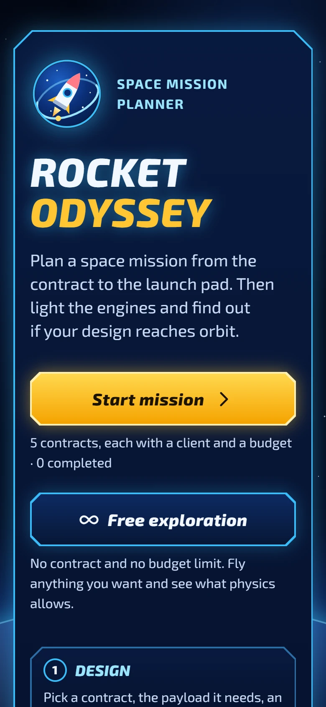
  &nbsp;
  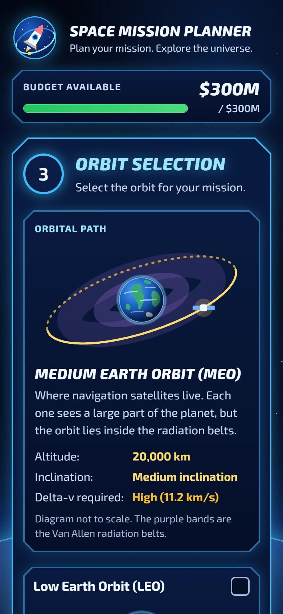
  &nbsp;
  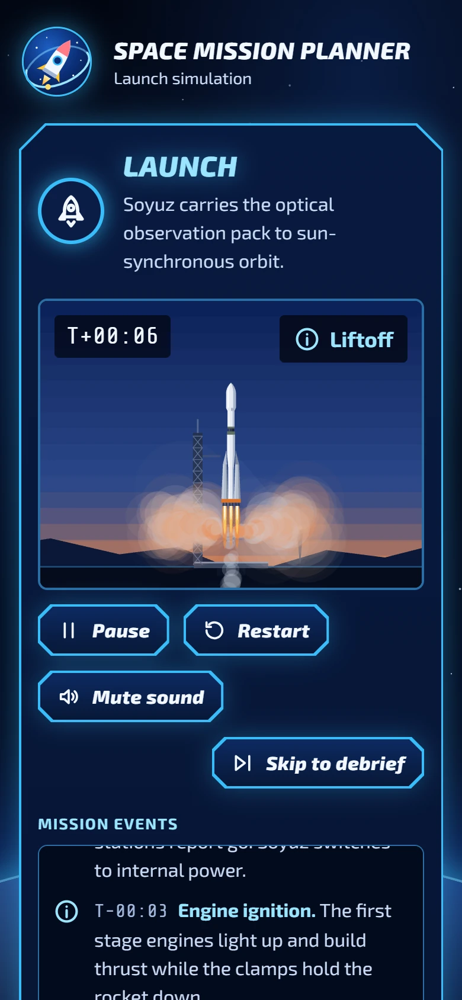
</p>
<p align="center"><sub>Every screen reflows down to 320 px wide, with no horizontal scrolling.</sub></p>

## Tech stack

| Area             | Technology                                                                                           |
| ---------------- | ---------------------------------------------------------------------------------------------------- |
| Language         | TypeScript 6.0 in strict mode, in every package                                                      |
| Game logic       | Plain TypeScript package (`packages/game-core`), validated with Zod                                  |
| UI               | React 19, Vite, React Aria Components, Tailwind CSS 4, React Router 8, Zustand                       |
| Launch animation | PixiJS 8 on a single `<canvas>`                                                                      |
| Sound            | Web Audio API, with tunes synthesised in the browser and no audio files                              |
| Server           | Hono on Node.js 24                                                                                   |
| Tests            | Vitest for unit tests; Playwright with `@axe-core/playwright` for end-to-end and accessibility tests |
| Quality          | ESLint 9 with `typescript-eslint` and `jsx-a11y`; Prettier                                           |
| Deployment       | Multi-stage `Dockerfile`, one Railway service                                                        |

## Architecture

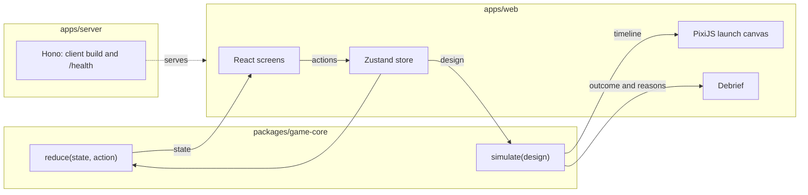

- **All game rules live in `packages/game-core`.** It has no dependency on React, the DOM, PixiJS or the server.
- **State is plain JSON**, validated with Zod when it enters the system, and it changes only through `reduce(state, action)`. The Zustand store is a thin binding over that reducer.
- **The simulation is deterministic.** The same design always gives the same outcome, which makes every rule testable.

## Getting started

### Requirements

- [Node.js](https://nodejs.org) 24 or later, with npm.
- Google Chrome, only to run the end-to-end tests.
- Docker, only to run the production image locally.

### Run it locally

```sh
npm install
npm run dev
```

Open <http://localhost:5173>. The client reloads when a file changes, and the server restarts on port 3000.

### Production build

```sh
npm run build
npm start
```

Open <http://localhost:3000>. Set the `PORT` environment variable to use another port. To run the same image that Railway runs:

```sh
docker compose up --build
```

### Commands

| Command             | What it does                                                                                                    |
| ------------------- | --------------------------------------------------------------------------------------------------------------- |
| `npm run dev`       | Vite dev server with hot reload, plus the server in watch mode. `/api` and `/health` are proxied to the server. |
| `npm run build`     | Builds the client into `apps/web/dist` and the server into `apps/server/dist`.                                  |
| `npm start`         | Serves the built client and `/health` on `PORT` (3000 by default).                                              |
| `npm test`          | Unit tests of the rules, the client helpers and the server.                                                     |
| `npm run test:e2e`  | Builds, starts the server on port 3100 and plays the game in Chrome, with WCAG 2.1 AA checks on every screen.   |
| `npm run typecheck` | TypeScript in strict mode over every package and the end-to-end tests.                                          |
| `npm run lint`      | ESLint, including the accessibility rules for JSX.                                                              |
| `npm run format`    | Prettier over the whole repository.                                                                             |

### Project structure

```
packages/game-core   Rules, catalogs, state, reducer and simulation. No UI dependencies.
apps/web             React client. Renders state, dispatches actions, plays the simulation back.
apps/server          Hono server. Serves the client build and the health check.
e2e                  End-to-end and accessibility tests.
docs/screenshots     Images used in this README.
ai                   Standards the project follows and the record of what was done.
```

## Deployment

The repository deploys to [Railway](https://railway.com) as one service, built from the `Dockerfile` and configured by `railway.json`. The server listens on `PORT` and Railway checks `/health`.

## Roadmap

- **Use case 2: orbital piloting.** Fly the spacecraft yourself: a Hohmann transfer in Earth orbit and a lunar orbit insertion, with real orbital mechanics. The specification is in [`ai/standards/use_case_2_orbit.md`](ai/standards/use_case_2_orbit.md).
- **Persistence.** Save and compare designs, with PostgreSQL on Railway and Drizzle ORM.
- **Multiplayer.** Cooperative play over WebSockets on the same Hono server, which would apply the same `game-core` reducer.

## Documentation

- [`ai/standards`](ai/standards) holds the rules the project follows: the brief, the tech stack and the use cases.
- [`ai/self_documentation/base.md`](ai/self_documentation/base.md) is the index of what has been built and why.

<div align="center">
<br>
<sub><a href="#rocket-odyssey">Back to top ↑</a></sub>
</div>
